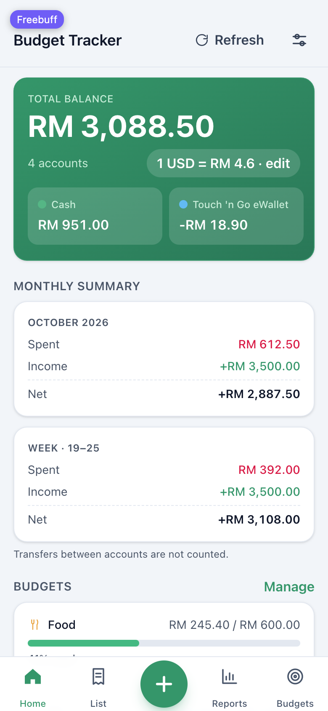
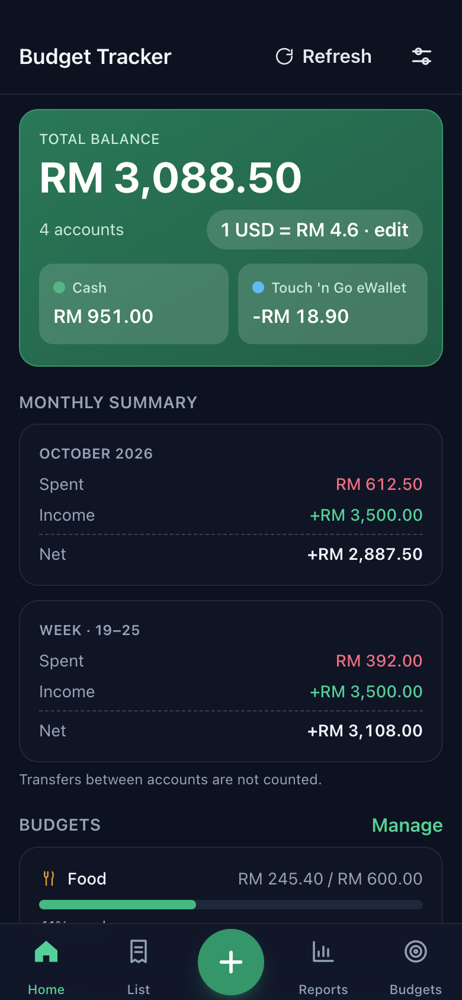
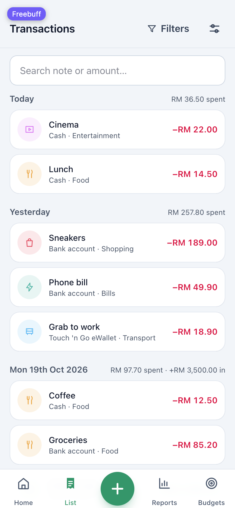
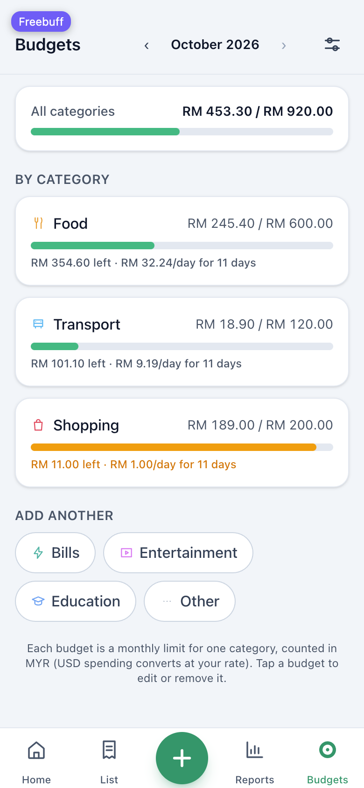
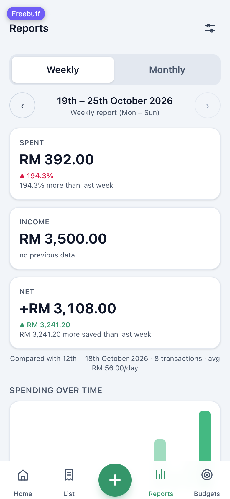
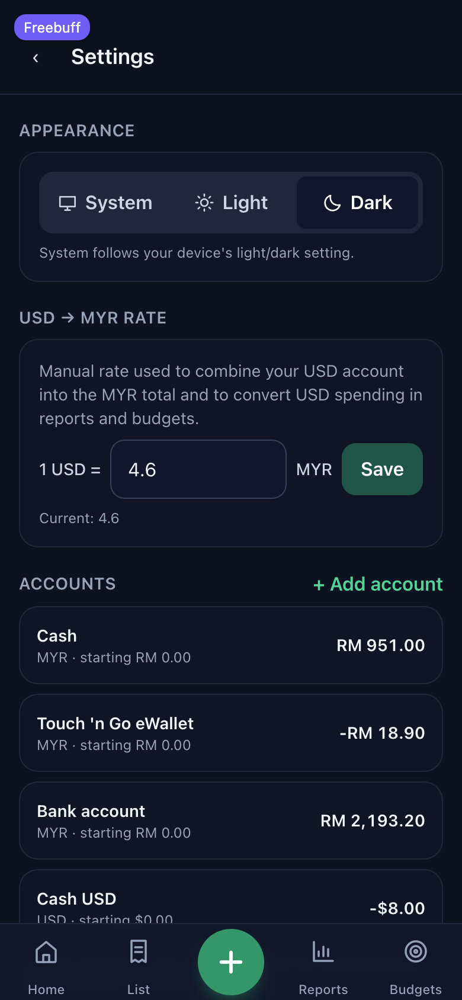

# Budget Tracker

A personal, mobile-first budget tracker: four wallets (Cash, Touch 'n Go, Bank, USD cash),
expenses / income / transfers, category budgets, weekly & monthly reports, CSV export, dark
mode, and a PWA you can add to your phone's home screen. One password, no sign-ups, no
recurring cost.

## Screenshots

| Home (light) | Home (dark) |
| --- | --- |
|  |  |

| Transactions | Budgets |
| --- | --- |
|  |  |

| Reports | Settings |
| --- | --- |
|  |  |

Four tabs sit in the bottom bar — **Home, List, +, Reports, Budgets** — with the green **+**
FAB dead-centre; **Settings** lives behind the gear icon in the top-right of every header.

## Tech stack — and why

| Layer | Choice | Why |
| --- | --- | --- |
| Frontend | **React 19 + Vite + TypeScript + Tailwind CSS 4** | Fast dev/build (~105 kB gzipped app), mobile-first with a bottom nav, no framework overhead for a pure SPA. |
| API | **Cloudflare Worker** (plain `fetch` handler) | Password check, rate limiting and session validation must never touch browser code, so everything runs server-side. |
| Database | **Cloudflare D1 (SQLite)** | Free tier, real SQL (joins/date ranges for reports), no separate vendor to manage — API + DB + static assets live on one platform and one account. |
| Auth | HttpOnly `SameSite=Strict` session cookie (30-day) + SHA-256 token hash in D1 | Password lives only in the `APP_PASSWORD` environment variable; every API request is checked server-side. Login attempts are rate limited (8 per 15 min per IP). |
| PWA | Manifest + hand-written service worker | App shell caches for instant loads and offline open; API responses are never cached. |

Supabase/Firebase would work too, but they add a second account, second dashboard and second
secret store for a single-user app; Vercel doesn't host a Worker + D1 pair, so it would mean
splitting the API and the database across providers. One Cloudflare Worker serving both the
API and the built SPA is the simplest thing that meets every requirement on the free tier.

## Folder structure

```
├── index.html                 # SPA shell (PWA meta, theme bootstrap)
├── public/                    # static assets copied into the build
│   ├── manifest.webmanifest   # PWA manifest (Add to Home Screen)
│   ├── sw.js                  # service worker (app shell cache, API = network only)
│   ├── _headers               # security headers for static assets
│   └── icons/                 # generated PNG icons (see scripts/gen-icons.mjs)
├── src/                       # frontend (TypeScript + React)
│   ├── App.tsx                # routes + auth gate
│   ├── components/            # ui primitives, charts (SVG donut/bars), bottom nav,
│   │                          # PageHeader (title + Settings gear)
│   ├── lib/                   # api client, money/date helpers, CSV builders, hooks
│   ├── pages/                 # Dashboard, AddTransaction, Transactions, Reports,
│   │                          # Budgets, Settings, Login
│   └── state/AppContext.tsx   # session + bootstrap data (accounts/categories/budgets/rate)
├── worker/                    # backend (Cloudflare Worker, bundled to build/worker.js)
│   ├── index.ts               # router, auth gate, security headers, asset fallback
│   ├── auth.ts                # login, rate limit, 30-day session cookies
│   ├── api.ts                 # accounts, categories, transactions, budgets, settings, backup/restore
│   ├── reports.ts             # dashboard + weekly/monthly report queries
│   ├── schema.ts              # D1 migrations + one-time seeds (recorded in schema_migrations)
│   └── util.ts, d1.d.ts       # helpers and binding types
├── scripts/
│   ├── build.mjs              # icons → vite build → worker bundle → deploy manifest
│   ├── gen-icons.mjs          # PNG icon generator (no image dependencies)
│   ├── smoke.mjs              # 154-assertion end-to-end API test
│   └── verify-live.mjs        # re-compute balances/reports against a deployed instance
├── docs/screenshots/          # the images in this README
├── wrangler.jsonc             # local dev config (local D1 + assets)
└── build/                     # deployable output: manifest.json, worker.js, public/
```

## Database schema (D1)

| Table | Purpose |
| --- | --- |
| `accounts` | Wallets: name, `MYR`/`USD`, starting balance, sort order, archived flag |
| `categories` | Presets with a **`kind`**: seven `expense` categories (Food, Transport, Bills, Shopping, Entertainment, Education, Other) plus five `income` ones (Allowance, Family, Salary, Gift, Other). Add/rename/delete in Settings; ones with history archive instead of deleting. Rows created before the `kind` column default to `expense`. |
| `transactions` | `expense` \| `income` \| `transfer`; amounts stored as **integer cents**; transfers carry `account_id` → `to_account_id` and are excluded from every spending/income report |
| `budgets` | One monthly amount per category |
| `settings` | Key/value (the manual `usd_myr_rate` and when it last changed) |
| `sessions` | SHA-256 hash of the session cookie + expiry |
| `login_attempts` | Rate-limit counters per IP |
| `schema_migrations` | Applied migration ids (`0001_initial`, `0002_category_kind`), each run exactly once |

Money is stored as integers (sen/cents), so balances are exact. USD balances stay in USD and
are converted at your manual rate for the combined total, budgets and reports.

Migrations are **additive and idempotent** — they run inside the Worker on the first API
request after a deploy, so schema changes ship with the code that needs them.

## Local development

```bash
npm install
printf 'APP_PASSWORD=your-local-password\n' > .dev.vars   # local-only password

npm run build          # icons + frontend + worker + deploy manifest
npm run api:dev        # wrangler dev → http://127.0.0.1:8788 (local D1, auto-migrates & seeds)
npm run dev            # vite dev → http://localhost:5173 (proxies /api to :8788)

npm run typecheck      # tsc --noEmit (frontend + worker)
node scripts/smoke.mjs # end-to-end API test against api:dev (run on a fresh local DB)

# against a deployed instance (recomputes balances/totals/reports independently):
BASE=https://your-site.example node scripts/verify-live.mjs
```

The database schema applies itself on the first API request and seeds your four accounts and
twelve categories once.

## Deployment (free)

The app deploys as **one Cloudflare Worker that serves the built SPA plus the API**, backed by
**one D1 database**. Steps with this app's Sites hosting:

1. **Create the site** — Sites → New site (e.g. "Budget Tracker").
2. **Create the database** — Sites → your site → Storage → add **D1**, binding name `DB`
   (Preview first). This is where all transactions live; it syncs across your devices because
   both phone and laptop call the same database.
3. **Build** — `npm run build` (outputs `build/manifest.json`, `build/worker.js`,
   `build/public/`).
4. **Deploy** — deploy `build/manifest.json` to the **Preview** environment.
5. **Set the password** — Sites → Secrets → add `APP_PASSWORD` with your login password.
   *Never* put the password in frontend code: it is read by the Worker on every login attempt
   and is not shipped to the browser. (Rotate it there whenever you want to kick a device off.)
6. **Open the preview URL**, sign in, set your **USD → MYR rate** under Settings.
7. When you're happy with the preview, publish **Production** (same steps; Preview and
   Production have separate databases — set the password and rate for each).

Any migration in `worker/schema.ts` applies itself on the first API request after the new
code is live, so there is no manual SQL step. Before shipping one, grab a safety copy:
Settings → **Download full backup (JSON)**, or `GET /api/backup` with a session — it is a
complete, restorable snapshot of every table.

**Same thing with the Wrangler CLI instead** (any Cloudflare account, free tier):

```bash
npx wrangler d1 create budget-tracker        # copy the database_id into wrangler.jsonc
npm run build
npx wrangler deploy build/worker.js --name budget-tracker --assets build/public --compatibility-date 2026-09-15
npx wrangler secret put APP_PASSWORD         # paste the password at the prompt
```

No Vercel/Supabase keys are required anywhere; the only environment variable in the whole app
is `APP_PASSWORD`.

## Using it

- **Navigation** — Home, List, Reports and Budgets in the bottom bar with the green **+** FAB
  centred between them; **Settings** is the gear in the header. Every target is at least
  44×44pt and the bar respects the iPhone home-indicator inset.
- **Add a transaction** — tap the green **+**: amount on the keypad → account → category →
  note/date → Save (sticky above the keypad). Income draws from the income categories
  (Allowance, Family, Salary, Gift, Other) and Expense from the spending ones; transfers pick
  two accounts and show a live cross-currency preview. Save stays disabled until the amount
  and category are set, and there are no preselected defaults.
- **Dashboard** — hero card with the combined MYR total and a per-account scroller, this week
  (Mon–Sun) and this month, budget progress, category donut (tap a slice to open those
  transactions), 13-week bar chart, recent transactions with category icons and short dates.
- **List** — searchable, grouped by day with daily totals for both spending *and* income;
  swipe a row to delete (with Undo), tap it to edit, and filter by account, category, type or
  date range with the Filters badge.
- **Reports** — Weekly (Mon–Sun) and Monthly, browse past periods with ‹ › (disabled past the
  current one), plain-language comparisons vs the previous period, spending-over-time chart,
  every expense category with a share, biggest expenses, budget performance, CSV export.
- **Budgets** — monthly cap per category with what's left and the daily pace to stay on track
  ("RM 564.30 left · RM 24/day for 11 days"); bars turn amber at 70% and red past 100%. Tap a
  budget to edit or remove it; add more from the icon chips.
- **Settings** — System/Light/Dark theme, USD → MYR rate (decimal keypad, save enabled only
  when it changes), accounts with editable starting balances plus rename/reorder/archive,
  categories with `↑` marking the income-only ones, CSV export, JSON backup **and restore**,
  sign out.
- **Phone** — browser menu → *Add to Home Screen*; the app installs standalone and opens
  offline.

## Notes

- Insurance and Medical aren't preset categories — add them in Settings → Categories.
- Archived categories/accounts keep their history and still count in reports.
- Sign out only clears the current device; sessions expire on their own after 30 days.
